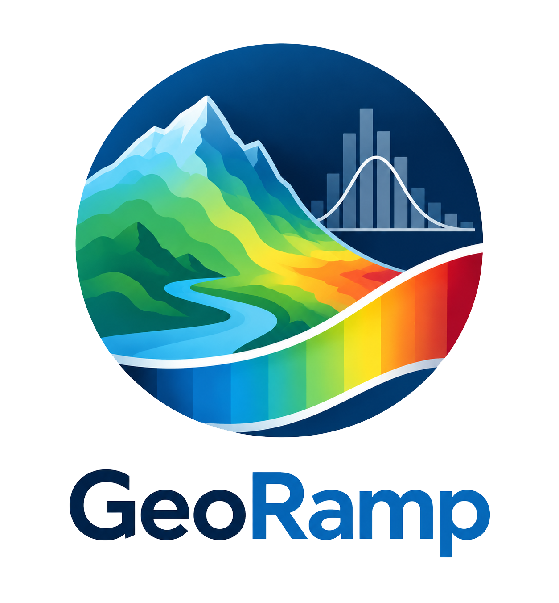
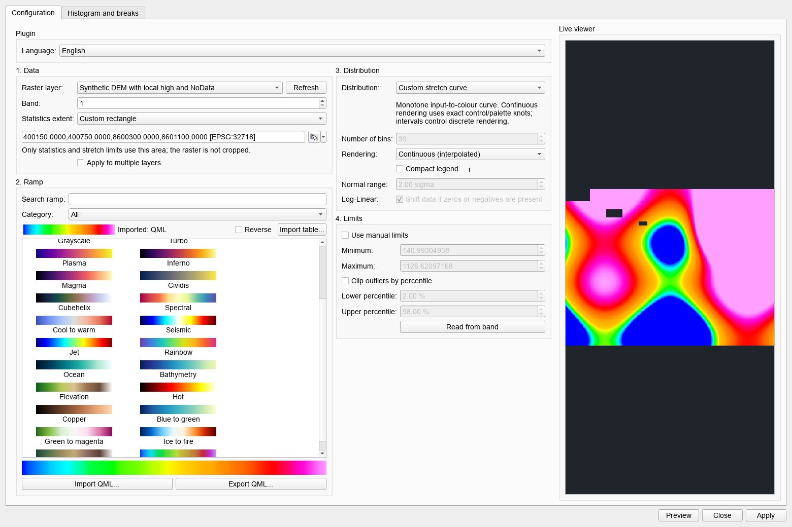
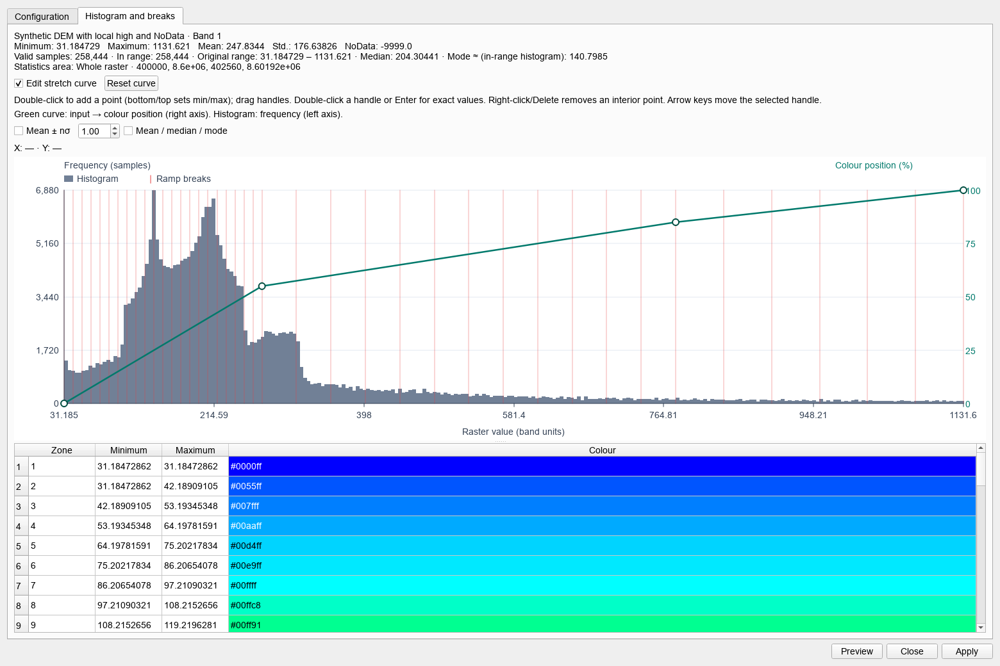

<strong>English</strong> · <a href="README.es.md">Español</a>

  

# GeoRamp

**Scientific colour ramps and interactive raster exploration for QGIS**

Inspect raster distributions, choose an explicit stretch and apply repeatable
continuous or classified colour tables without losing NoData semantics.

[Install in QGIS](#install-the-qgis-plugin) · [Features](#capabilities) · [VS Code extension](#georamp--geotiff--raster-viewer) · [Report an issue](https://github.com/jordan-zav/GeoRamp/issues)

> [!IMPORTANT]
> A colour ramp changes visualization, not raster values. Distribution choice,
> clipping and class limits can emphasize or suppress anomalies; preserve the
> original raster and record the style used for interpretation.

## Two interfaces, one visualization model

| Product | Purpose |
| --- | --- |
| QGIS plugin | Apply styles to loaded raster layers, inspect statistics and export QML |
| VS Code extension | Open GeoTIFF/BigTIFF previews with the same style concepts during development or data review |

The QGIS plugin is the primary GIS workflow. The VS Code extension is under
active internal development and does not replace CRS-aware analysis in QGIS.

## Workflow at a glance

~~~text
Raster layer / GeoTIFF
        │
        ▼
 Band + valid-data statistics + histogram
        │
        ▼
 Distribution + limits + intervals + colour ramp
        │
        ▼
 Live preview and class-break review
        │
        ├──► QGIS renderer / QML style
        └──► bounded VS Code raster preview
~~~

## Capabilities

| Area | Included support |
| --- | --- |
| Distributions | Linear, Normal, Equal Area/Histogram and Log-Linear |
| Ramps | 27 built-in geophysical, scientific, divergent, topographic and bathymetric ramps |
| Import | Text <code>CSV</code>, <code>TXT</code>, <code>TBL</code>, <code>ZON</code>, <code>CLR</code> and <code>LUT</code> colour tables |
| Classification | 2–255 intervals, continuous or discrete representation |
| Limits | Automatic/manual bounds, ramp inversion, sigma and percentile clipping |
| Inspection | Responsive histogram, cursor coordinates, mean, median, approximate mode and observed coverage within mean ± n standard deviations |
| Scale | Multi-layer selection by drag, Ctrl/Shift or QGIS layer groups; live preview of the first selected layer |
| Persistence | Language, last configuration, imported table and QML style exchange |
| Localization | Spanish and English interface |

## Distribution models

| Distribution | Appropriate use |
| --- | --- |
| Linear | Uniform interpolation between selected minimum and maximum |
| Normal | Emphasize deviations around a mean using configurable sigma |
| Equal Area | Allocate similar valid-pixel counts to each interval |
| Log-Linear | Expand low positive values and compress a long positive tail |

NoData values are excluded from statistics and histograms. Logarithmic styling
requires a valid positive domain or an explicitly reviewed shift.

## Colour-table format

GeoRamp accepts <code>R,G,B</code> or <code>position,R,G,B</code> rows separated by commas,
semicolons or whitespace. Positions are sorted and normalized to 0–1; RGB values
must be between 0 and 255.

~~~text
position,R,G,B
0,0,0,255
25,0,255,255
50,0,255,0
75,255,255,0
100,255,0,0
~~~

Imported colour tables are user-supplied data. Built-in ramps are independent
visual approximations and are not proprietary commercial colour tables.

## Install the QGIS plugin

1. build <code>dist/georamp-1.1.0.zip</code> using <code>python scripts/package_plugin.py</code>; this version is local experimental development. Published assets, when available, are in [GitHub Releases](https://github.com/jordan-zav/GeoRamp/releases);
2. open **Plugins → Manage and Install Plugins** in QGIS;
3. choose **Install from ZIP**; and
4. enable GeoRamp, then open **Raster → GeoRamp**.

The minimum supported version declared by the plugin is QGIS 3.34.

QGIS Plugins submission is pending. ZIP files are generated locally and are not
included in the source checkout.

## QGIS usage

1. load one or more raster layers;
2. select the layer, band and distribution;
3. choose a ramp and continuous/discrete representation;
4. review histogram, clipping and proposed class limits;
5. preview before applying; and
6. save the style as QML when reproducibility matters.

See the [plugin-specific guide](georamp/README.md) for the complete interface
behavior and text-table examples.

## Extent stretches and editable curves

In Configuration, Statistics extent offers the whole raster, a fixed snapshot of
the current main QGIS canvas, a following canvas extent, a custom rectangle or
a polygon area from a layer/feature selection or a polygon drawn on the map.
The rectangle can be entered numerically or drawn on the main map through QGIS's
native extent widget. Canvas coordinates are transformed to each raster's CRS and
intersected with its extent. Reprojected rectangles use bounding envelopes.
An empty/NoData-only or constant area is reported instead of falling back to the
whole raster. Polygon areas mask sample centres outside their actual geometry,
including holes, rather than using only their bounding rectangle. The source
raster is never cropped or rewritten.

Apply in Follow mode arms automatic stretching for the selected project layer(s).
Panning/zooming then updates their actual renderers even after the GeoRamp window
closes. Stop automatic stretching is available in the dialog and Raster menu.
Each layer retains its own ramp, band and parameters; an external style change
stops following for that layer. Removing layers or unloading GeoRamp cancels
their jobs. A non-overlapping area retains the last valid style and reports the
reason; it does not silently stretch the whole raster. Saved projects can resume
following while GeoRamp is loaded. Sampling remains a deterministic 512 by 512
grid per requested area, not full-resolution statistics.
Percentile and normal parameters use that area's valid samples. Manual limits
override automatic/percentile limits until disabled.

Histogram and breaks overlays the rendered input-to-colour transfer in green.
The left axis is sample frequency; the right axis is colour position in percent.
Continuous rendering shows the interpolated transfer; discrete rendering shows
its steps. Select Edit stretch curve to start from the current break relationship.

- Double-click empty space to add an intermediate point. Near the bottom/top,
  double-click sets the minimum/maximum handle.
- Drag a handle to adjust the input value and colour position. Endpoint colour
  positions stay at zero and one; nodes cannot cross or reverse the transfer.
- Double-click a handle or press Enter for exact numeric values. Arrow keys move
  a selected handle. Right-click or Delete removes an interior point.
- Reset curve restores the previous built-in distribution. Apply commits edits;
  closing the dialog alone does not apply the preview.

Continuous custom curves preserve control nodes and palette-stop crossings in the
native QGIS shader; their number of entries is determined by those knots. The
interval setting applies to discrete custom rendering. Custom curves use up to
64 monotone control points and are normalized within their current manual or
automatic limits. Changing the sampled area can rescale their input domain.

QML contains a native renderer plus GeoRamp's editable curve, band, limits,
palette, NoData rules and sampling-area/polygon metadata. Native QGIS can render it
without GeoRamp. GeoRamp restores editing controls when importing the QML or
selecting a layer with this metadata. Saved area metadata is restored as a fixed
snapshot, so importing a style does not silently resume following the canvas.
The separately versioned VS Code extension does not implement these new GUI
controls; its existing QML support has not been extended in this change.

## GeoRamp — GeoTIFF & Raster Viewer

From <code>vscode-georamp</code>:

~~~powershell
npm install
npm run typecheck
npm test
npm run build
npm run package:vsix
~~~

The extension registers **GeoRamp: Open GeoTIFF Viewer** for <code>.tif</code> and <code>.tiff</code>
files. Large TIFF/BigTIFF files are decoded into a bounded preview controlled by
<code>georamp.previewMaxDimension</code>; this preview is not a full-resolution export.
Version 0.4.0 adds QGIS-style histogram inspection, batch styling, saved preferences
and single-band pseudocolor QML exchange. See the [extension guide](vscode-georamp/README.md)
for supported QML renderers and sampling limitations.

## Development and verification

### QGIS/Python

~~~powershell
python -m pip install -r requirements-dev.txt
python -m pytest -q
python scripts/package_plugin.py
~~~

### VS Code/TypeScript

~~~powershell
cd vscode-georamp
npm run typecheck
npm test
npm run check:webview
~~~

Software tests should be complemented with visual checks on constant, skewed,
signed and NoData-rich rasters.

## Repository map

| Path | Contents |
| --- | --- |
| <code>georamp</code> | QGIS plugin, metadata, ramps and localized interface |
| <code>vscode-georamp</code> | VS Code custom GeoTIFF editor |
| <code>tests</code> | Python distribution and metadata tests |
| <code>test-data</code> | Small raster/style fixtures |
| <code>scripts/package_plugin.py</code> | Reproducible QGIS ZIP builder |
| <code>.github/workflows/tests.yml</code> | Automated Python and extension quality gates |

## Project status

The QGIS plugin is now local experimental version 1.1.0, following the 1.0.0
submission baseline. It has not been pushed or published as part of this update.
The independently versioned VS Code extension remains 0.4.1.

Executed validation: 21 Python tests and Ruff passed. The packaged GUI was run
with QGIS 3.44.12, Qt offscreen, a synthetic two-band DEM and an isolated profile.
Checks cover whole/fixed/follow/custom/drawn extents, CRS envelopes, empty areas,
source/user NoData, mouse/keyboard editing, numeric input, QML round trips,
discrete saturation, successive tasks, band changes and unload during a task.
Additional checks cover actual applied-layer following with the dialog closed,
independent palettes for followed layers, polygon masks/holes/selections, polygon
CRS transforms, drawing/cancellation and shorter configuration windows.
Raster SHA-256 stayed unchanged; native QML preserved user-NoData transparency.
No real user profile or private dataset was modified. Other QGIS versions declared
by metadata have not been exercised in this validation.

For reproduction in this managed Windows workspace, use DEVRESOURCES_RUN.cmd
before development commands. The real-runtime check is:

    scripts/run_qgis_python.cmd tests/qgis_smoke.py dist/georamp-1.1.0.zip

The launcher defaults to the installed QGIS 3.44.12; GEORAMP_QGIS_ROOT overrides
that local path. The synthetic GUI test writes validation details under the
DevResources session and English captures under assets/screenshots.

The ZIP was also installed via QGIS's plugin manager in a fresh, visible Windows
desktop profile. Automated mouse interactions and rendering checks used a real
[public Terrain Tiles DEM](https://registry.opendata.aws/terrain-tiles/), tile
S13W073 in Peru. The native application exited normally, the source file stayed
byte-identical, and screenshots were visually reviewed. This is a desktop GUI
test with automation, not a claim of human acceptance testing or exact commercial
software equivalence. See the [validation report](docs/VALIDATION_1_1_0.md).

To reproduce the visible desktop review, run scripts/qgis_desktop_review.py with
QGIS's Python launcher, providing --bundle, --dem, a new --output directory and
--qgis-bin. The review creates its own profile and never installs into the user's
normal QGIS profile.

## License and contact

GeoRamp is distributed under the [GNU General Public License v3.0](LICENSE).
Third-party runtime packages retain their own compatible licenses.

Jordan Zavaleta — GisGeo Dev 
[jordanzav@gisgeo.dev](mailto:jordanzav@gisgeo.dev) · [gisgeo.dev](https://gisgeo.dev)
